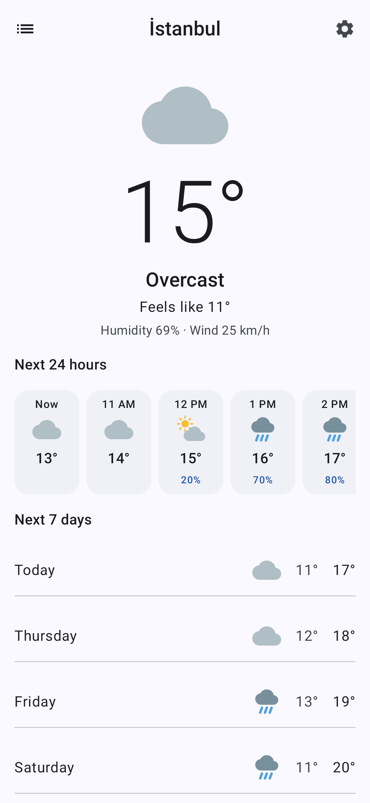
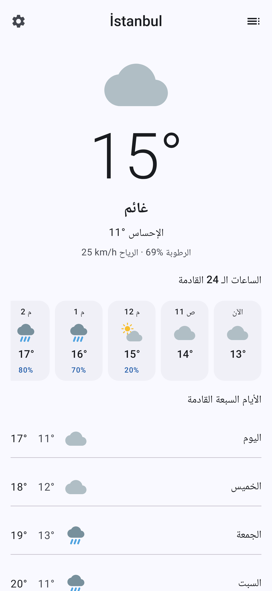
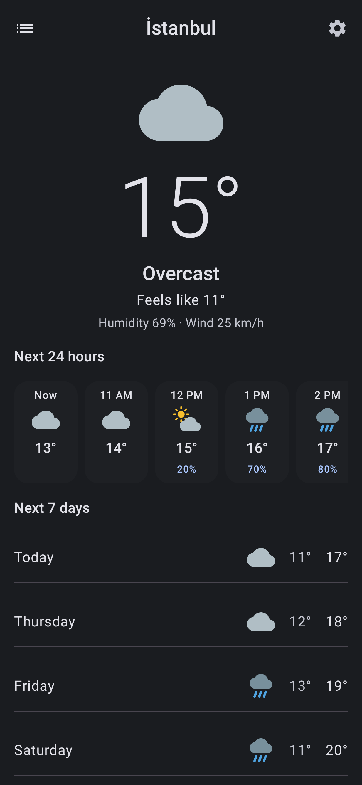
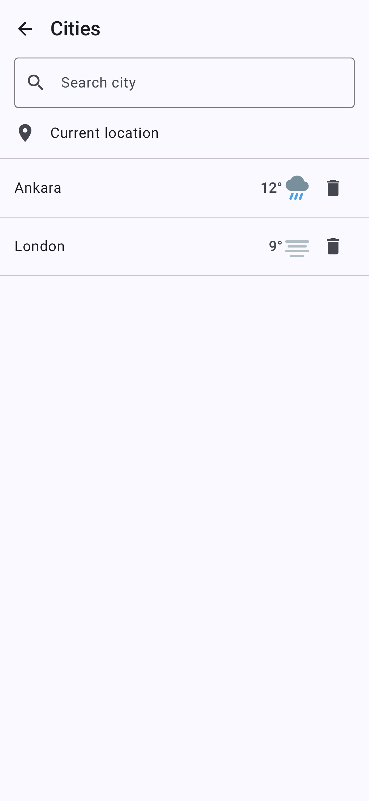
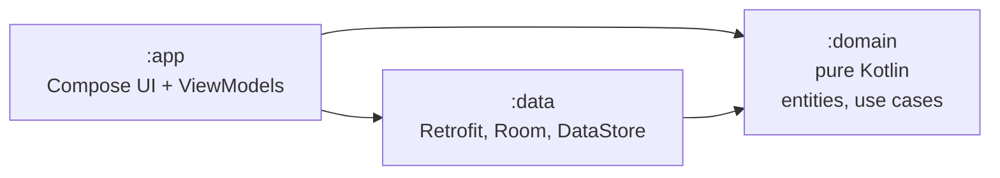

# Atmos — Android

**A weather app built step by step, as a public tutorial on professional Android
development with Clean Architecture and an AI coding agent.**


-blue)


[](https://github.com/AhmedJAbuSada/atmos-android/actions/workflows/ci.yml)

> ✅ **Version 1.0.0.** All seven steps are done. The Android app is complete; iOS, React
> Native and Flutter follow the same plan.

| Home | Arabic (RTL) | Dark | Cities |
|---|---|---|---|
|  |  |  |  |

<sub>Rendered from the real Compose code by CI ([ScreenshotTest](app/src/test/kotlin/dev/ahmedabusada/atmos/screenshots/ScreenshotTest.kt)).
More in [docs/screenshots](docs/screenshots/).</sub> Follow along in [PROGRESS.md](docs/PROGRESS.md).

## Why this repository exists

Most sample apps show only the finished code. This one shows **how a professional
project grows**, one level per branch, from documents to a released app, with each step
explained:

| Step | Branch | What you learn |
|---|---|---|
| 01 | [`step-01-planning`](../../tree/step-01-planning) | PRD, user stories, API contract, architecture, ADRs, team process, AI agent rules |
| 02 | [`step-02-project-structure`](../../tree/step-02-project-structure) | Gradle modules that enforce Clean Architecture, DI, linting, CI |
| 03 | [`step-03-domain-layer`](../../tree/step-03-domain-layer) | Entities, use cases, errors as values, pure unit tests |
| 04 | [`step-04-data-layer`](../../tree/step-04-data-layer) | Retrofit, mappers, Room cache, DataStore, cache-first repositories |
| 05 | [`step-05-presentation-ui`](../../tree/step-05-presentation-ui) | Design system, stateless Compose screens, previews (dark, RTL, large font) |
| 06 | [`step-06-integration`](../../tree/step-06-integration) | ViewModels, real data, location, search, offline mode, navigation |
| 07 | [`step-07-quality-release`](../../tree/step-07-quality-release) | Localization, accessibility, performance, UI tests, release |
| — | `main` | The finished app |

Full details: [ROADMAP.md](docs/ROADMAP.md).

## The same app on four platforms

| Platform | Repository |
|---|---|
| **Android** (Kotlin, Compose) | you are here |
| iOS (Swift, SwiftUI) | [atmos-ios](https://github.com/AhmedJAbuSada/atmos-ios) |
| React Native (TypeScript) | [atmos-react-native](https://github.com/AhmedJAbuSada/atmos-react-native) |
| Flutter (Dart) | [atmos-flutter](https://github.com/AhmedJAbuSada/atmos-flutter) |

Same features, same architecture, same step-by-step plan. Compare how each platform
solves the same problem.

## Features (v1.0)

- 📍 Current weather at your location
- 🕐 Next 24 hours and 🗓 next 7 days
- 🔍 City search with names in your language, ⭐ saved cities
- 📴 Works offline with the last known data
- 🌡 °C / °F, km/h / m/s / mph
- 🌙 Dark mode
- 🌍 **English, Türkçe, العربية** (full right-to-left layout)

Weather data by [Open-Meteo.com](https://open-meteo.com/). No API key is needed:
clone and run.

## Architecture at a glance



The domain depends on nothing. The compiler enforces it, because each layer is its own
Gradle module. Read [ARCHITECTURE.md](docs/architecture/ARCHITECTURE.md).

## 🤖 Built with an AI agent, the professional way

This project is built by a developer working with **Claude Code**. The repository shows
the whole method, not just the result:

- [**AI_WORKFLOW.md**](docs/AI_WORKFLOW.md): the spec → plan → review → build → verify →
  review loop, what to delegate and what not, and how to verify AI output.
- [**AGENTS.md**](AGENTS.md): the rules file every AI session loads, so it follows the
  architecture.
- [**docs/ai/prompts/**](docs/ai/prompts/): the real prompts used at each step.
- Every step guide ends with **"How the AI agent helped in this step"**, including what
  went wrong.
- Commits written with the agent carry a `Co-Authored-By: Claude` line.

## Quality, in numbers

| | |
|---|---|
| JVM tests (unit, ViewModel, data, screenshot rendering) | 144 |
| Line coverage gates (fail the build below) | `:domain` 90%, `:data` 80% |
| End-to-end test on an Android emulator, real API | 1 journey |
| Release (R8) build smoke-tested on an emulator | every push |
| Languages | English, Türkçe, العربية (RTL) |
| Secrets in the repository | 0 (no API key needed; signing from the environment) |

## Run it

Requirements: Android Studio (latest stable), or JDK 21 plus the Android SDK.

```bash
git clone https://github.com/AhmedJAbuSada/atmos-android.git
cd atmos-android
./gradlew assembleDebug
```

Quality checks, the same ones CI runs:

```bash
./gradlew spotlessCheck checkLocaleSafeCasing lint test
```

## Start reading

1. [Step 01 guide](docs/steps/01-planning.md)
2. [PRD](docs/product/PRD.md) → [User stories](docs/product/USER_STORIES.md)
3. [Architecture](docs/architecture/ARCHITECTURE.md) → [ADRs](docs/architecture/adr/)
4. [AI workflow](docs/AI_WORKFLOW.md)

## Author

**Ahmed J. AbuSada**, senior mobile and front-end developer.
GitHub: [@AhmedJAbuSada](https://github.com/AhmedJAbuSada)

## License

[MIT](LICENSE). Weather data © Open-Meteo.com, [CC BY 4.0](https://creativecommons.org/licenses/by/4.0/).
