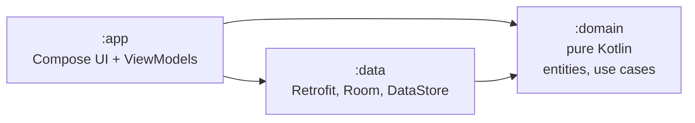

# Atmos — Android

**A weather app built step by step, as a public tutorial on professional Android
development with Clean Architecture and an AI coding agent.**

<!-- step-banner:start -->
## 📍 You are on Step 01 of 7 — Planning: documents before code

`step-01-planning` · [Step 02 →](https://github.com/AhmedJAbuSada/atmos-android/tree/step-02-project-structure) · [All steps](docs/ROADMAP.md)

**What this step is.** There is **no code** in this branch, on purpose. Before anyone writes code, the team agrees on *what* to build (requirements with IDs), *how we know it works* (acceptance criteria), *what the server really sends* (an API contract written against recorded responses), *how the code is organised* (Clean Architecture and decision records), and *how the team and the AI agent work* (Git workflow, Definition of Done, `AGENTS.md`).

**Why it matters.** An hour of planning saves a week of rework. With an AI agent this matters even more: the agent builds exactly what you describe, so a vague description becomes vague software, fast. Every later step traces back to an ID in these documents.

**What you will find in this branch**

| Where | What |
|---|---|
| `docs/product/PRD.md` | What and why: goals, non-goals, requirements F-01…F-11, NF-01…NF-09 |
| `docs/product/USER_STORIES.md` | Given/When/Then acceptance criteria; they become test names |
| `docs/api/API_CONTRACT.md` | The Open-Meteo boundary, with real recorded responses in docs/api/samples |
| `docs/architecture/` | Clean Architecture rules and six ADRs (one decision per file) |
| `docs/process/` | Git workflow, coding standards, Definition of Done |
| `AGENTS.md, docs/AI_WORKFLOW.md` | How to work with an AI coding agent professionally |

**How to study this step**

1. **Read the full guide:** [docs/steps/01-planning.md](docs/steps/01-planning.md): key ideas, diagrams, and *how the AI agent helped* (including what went wrong).
2. **Read in this order:** PRD → user stories → API contract → architecture → ADRs → AGENTS.md.
3. **Try the exercise:** Add a user story for a non-goal (for example a home-screen widget). Which requirement ID does it need? Which ADR might it change?

> This README shows the project *as it was at this step*. The finished app is on
> [`main`](https://github.com/AhmedJAbuSada/atmos-android).

---
<!-- step-banner:end -->

-blue)

> 🚧 **In progress:** step 01 of 7 is done. Follow along in [PROGRESS.md](docs/PROGRESS.md).

## Why this repository exists

Most sample apps show only the finished code. This one shows **how a professional
project grows**, one level per branch, from documents to a released app, with each step
explained:

| Step | Branch | What you learn |
|---|---|---|
| 01 | [`step-01-planning`](../../tree/step-01-planning) | PRD, user stories, API contract, architecture, ADRs, team process, AI agent rules |
| 02 | `step-02-project-structure` | Gradle modules that enforce Clean Architecture, DI, linting, CI |
| 03 | `step-03-domain-layer` | Entities, use cases, errors as values, pure unit tests |
| 04 | `step-04-data-layer` | Retrofit, mappers, Room cache, DataStore, cache-first repositories |
| 05 | `step-05-presentation-ui` | Design system, Compose screens, ViewModels, previews (dark, RTL) |
| 06 | `step-06-integration` | Real data, location, search, offline mode, navigation |
| 07 | `step-07-quality-release` | Localization, accessibility, performance, UI tests, release |
| — | `main` | The finished app |

Full details: [ROADMAP.md](docs/ROADMAP.md).

## The same app on four platforms

| Platform | Repository |
|---|---|
| **Android** (Kotlin, Compose) | you are here |
| iOS (Swift, SwiftUI) | [atmos-ios](https://github.com/AhmedJAbuSada/atmos-ios) |
| React Native (TypeScript) | [atmos-react-native](https://github.com/AhmedJAbuSada/atmos-react-native) |
| Flutter (Dart) | [atmos-flutter](https://github.com/AhmedJAbuSada/atmos-flutter) |

Same features, same architecture, same step-by-step plan. Compare how each platform
solves the same problem.

## Features (v1.0)

- 📍 Current weather at your location
- 🕐 Next 24 hours and 🗓 next 7 days
- 🔍 City search with names in your language, ⭐ saved cities
- 📴 Works offline with the last known data
- 🌡 °C / °F, km/h / m/s / mph
- 🌙 Dark mode
- 🌍 **English, Türkçe, العربية** (full right-to-left layout)

Weather data by [Open-Meteo.com](https://open-meteo.com/). No API key is needed:
clone and run.

## Architecture at a glance

The domain depends on nothing. The compiler enforces it, because each layer is its own
Gradle module. Read [ARCHITECTURE.md](docs/architecture/ARCHITECTURE.md).

## 🤖 Built with an AI agent, the professional way

This project is built by a developer working with **Claude Code**. The repository shows
the whole method, not just the result:

- [**AI_WORKFLOW.md**](docs/AI_WORKFLOW.md): the spec → plan → review → build → verify →
  review loop, what to delegate and what not, and how to verify AI output.
- [**AGENTS.md**](AGENTS.md): the rules file every AI session loads, so it follows the
  architecture.
- [**docs/ai/prompts/**](docs/ai/prompts/): the real prompts used at each step.
- Every step guide ends with **"How the AI agent helped in this step"**, including what
  went wrong.
- Commits written with the agent carry a `Co-Authored-By: Claude` line.

## Start reading

1. [Step 01 guide](docs/steps/01-planning.md)
2. [PRD](docs/product/PRD.md) → [User stories](docs/product/USER_STORIES.md)
3. [Architecture](docs/architecture/ARCHITECTURE.md) → [ADRs](docs/architecture/adr/)
4. [AI workflow](docs/AI_WORKFLOW.md)

## Author

**Ahmed J. AbuSada**, senior mobile and front-end developer.
GitHub: [@AhmedJAbuSada](https://github.com/AhmedJAbuSada)

## License

[MIT](LICENSE). Weather data © Open-Meteo.com, [CC BY 4.0](https://creativecommons.org/licenses/by/4.0/).
