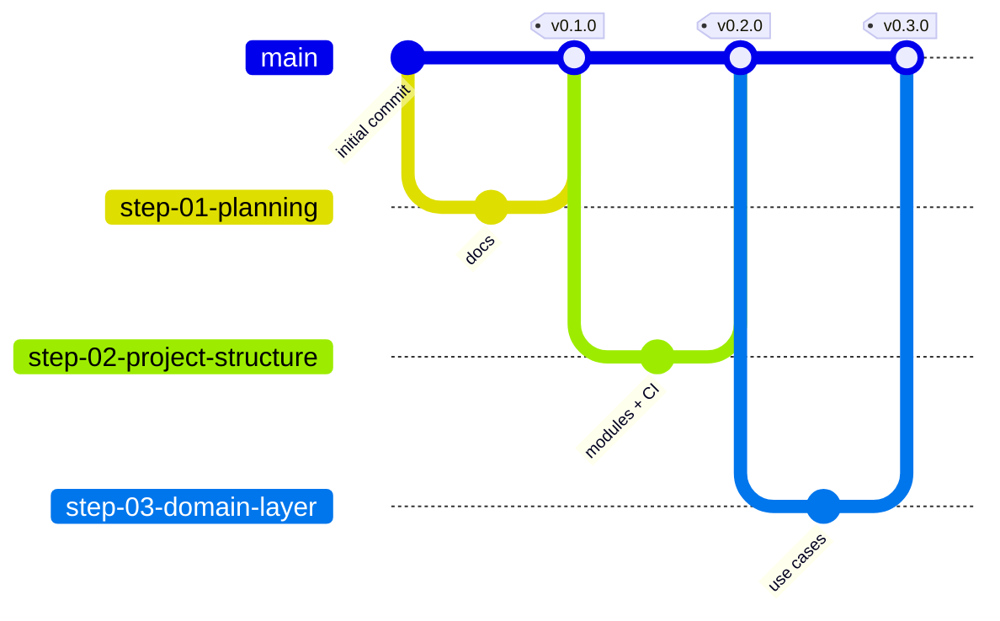

# Roadmap — the seven steps

Each step is a branch. Each branch contains everything from the step before, plus one new
level. Check out any branch to see the project exactly as it was at that point.

```bash
git clone https://github.com/AhmedJAbuSada/atmos-android.git
cd atmos-android
git switch step-03-domain-layer   # any step
```

| Step | Branch | Tag | You learn | Guide |
|---|---|---|---|---|
| 01 | `step-01-planning` | `v0.1.0` | Requirements, user stories, API contract, architecture and ADRs, team process, AI agent rules | [01-planning.md](steps/01-planning.md) |
| 02 | `step-02-project-structure` | `v0.2.0` | Gradle modules that enforce Clean Architecture, version catalog, DI, lint/format/static analysis, CI | [02-project-structure.md](steps/02-project-structure.md) |
| 03 | `step-03-domain-layer` | `v0.3.0` | Entities, repository interfaces, use cases, errors as values, testing pure business logic | [03-domain-layer.md](steps/03-domain-layer.md) |
| 04 | `step-04-data-layer` | `v0.4.0` | DTOs, Retrofit, mappers, Room cache, DataStore, cache-first repositories, testing with recorded responses | [04-data-layer.md](steps/04-data-layer.md) |
| 05 | `step-05-presentation-ui` | `v0.5.0` | Design system, Compose screens with fake data, ViewModels, UI state, previews (dark, RTL) | 05-presentation-ui.md |
| 06 | `step-06-integration` | `v0.6.0` | Wiring UI to real data, location permission, search, offline mode, navigation | 06-integration.md |
| 07 | `step-07-quality-release` | `v0.7.0` | Localization (en/tr/ar), accessibility, performance, UI tests, release build | 07-quality-release.md |
| — | `main` | `v1.0.0` | The finished app | — |

Guides without links are not written yet; they appear when their step lands.

## How each step is built



Every step follows the same loop from [AI_WORKFLOW.md](AI_WORKFLOW.md): spec → plan →
review → build with tests → verify → review → merge.
