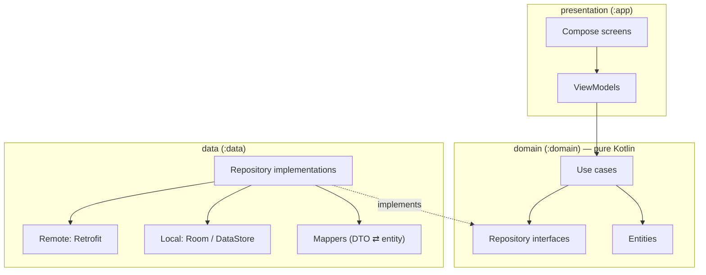
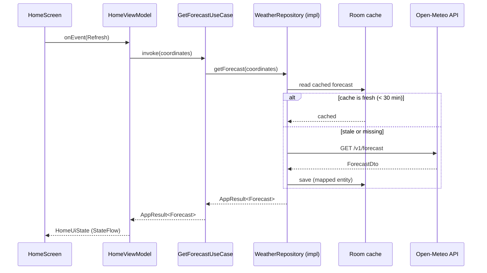

# Architecture

Atmos follows **Clean Architecture** with three layers. This document explains the
*rules*. The *reasons* for each choice are in the [ADRs](adr/).

## 1. The one rule: dependencies point inwards



- **presentation** depends on **domain**.
- **data** depends on **domain** (it *implements* the domain's interfaces).
- **domain** depends on **nothing**: no Android, no Retrofit, no Room, no Compose.

Only `:app` knows about all three modules, because it builds the dependency graph
(Hilt). That is the "composition root".

> **Why does this matter?** The business rules ("data older than 30 minutes is stale",
> "convert °C to °F", "current location is always first") live in the domain. They are
> the part of the app that changes least and matters most. Because the domain imports no
> framework, it is tested in milliseconds on the JVM. You can also swap Retrofit for Ktor,
> or Room for SQLDelight, without touching a single business rule.

## 2. Modules

We enforce the rule with **Gradle modules**, not just packages. With packages, nothing
stops someone importing Room into a use case. With modules, the build fails.

| Module | Type | Depends on | Contains |
|---|---|---|---|
| `:domain` | Kotlin/JVM library | — | Entities, repository interfaces, use cases, domain errors |
| `:data` | Android library | `:domain` | DTOs, Retrofit services, Room database, DataStore, mappers, repository implementations |
| `:app` | Android application | `:domain`, `:data` | Compose UI, ViewModels, navigation, design system, Hilt modules, resources and translations |

```
atmos-android/
├── app/        → presentation + composition root
├── data/       → data layer
├── domain/     → business core
└── gradle/libs.versions.toml   → one place for all dependency versions
```

## 3. Packages: by feature inside each layer

Inside each module, code is grouped by **feature**, so related code stays together:

```
domain/src/main/kotlin/dev/ahmedabusada/atmos/domain/
├── weather/      Forecast, CurrentWeather, WeatherCondition, GetForecastUseCase …
├── location/     Coordinates, City, SearchCitiesUseCase …
├── settings/     UserSettings, TemperatureUnit, …
└── common/       AppResult, DomainError, Clock abstraction
```

The same `weather/`, `location/`, `settings/` folders appear in `:data` and `:app`.

## 4. Data flow (one request, end to end)



## 5. Rules per layer

### Domain
- Pure Kotlin. Allowed dependencies: Kotlin standard library, `kotlinx-coroutines-core`,
  `javax.inject` (for `@Inject` only).
- **Entities** are immutable `data class`es with domain names (`temperatureCelsius`, not
  `temperature_2m`).
- **Use cases** do one thing, are named `VerbNounUseCase`, and expose one
  `operator fun invoke(...)`.
- **Repository interfaces** speak in entities, never DTOs.
- Errors are values: functions return `AppResult<T>` (success or `DomainError`). No
  exceptions cross a layer boundary (ADR-0006).
- Time comes from an injected `Clock`, never `System.currentTimeMillis()`, so tests can
  control it.

### Data
- **DTOs** mirror the JSON exactly and live only in `:data`. Every field is nullable.
- **Mappers** are pure functions (`ForecastDto.toDomain()`), unit tested against the
  recorded samples in [`docs/api/samples`](../api/samples/).
- Repository implementations decide the strategy (cache first, then network) and turn
  every exception into a `DomainError`.
- Nothing in `:data` is `public` unless the composition root needs it (`internal` by
  default).

### Presentation
- **Unidirectional data flow:** the screen sends `UiEvent`s; the ViewModel exposes one
  `StateFlow<UiState>`; the screen renders it. The screen holds no business logic.
- `UiState` is an immutable `data class` (or a sealed interface for loading, content and
  error).
- Composables are **stateless** where possible (state hoisting) and have `@Preview`s,
  including Arabic RTL and dark mode.
- All user-facing text comes from `strings.xml` (`values`, `values-tr`, `values-ar`).
- Formatting (numbers, dates, units) uses the **app locale**, never the default JVM
  locale.

## 6. Cross-cutting concerns

| Concern | Where | How |
|---|---|---|
| Dependency injection | `:app` (+ `@Inject` constructors everywhere) | Hilt (ADR-0004) |
| Threading | data layer | Repositories switch to `Dispatchers.IO` themselves; callers never need to. |
| Logging | data and presentation | A thin `Logger` interface; no logs in release builds. |
| Localization | presentation | ADR-0005 |
| Settings | data (DataStore) → domain (`UserSettings`) | Exposed as `Flow<UserSettings>`, so the UI reacts instantly. |

## 7. Testing strategy

| Layer | Test type | Tools | Target |
|---|---|---|---|
| Domain | Unit (JVM) | JUnit, kotlinx-coroutines-test, Turbine | ≥ 90% |
| Data | Unit (JVM) + integration | MockWebServer with the recorded samples, Room in-memory | ≥ 80% |
| Presentation | ViewModel unit tests; Compose UI tests; screenshot tests | Turbine, compose-ui-test | Every ViewModel; key flows |

The **test pyramid**: many fast unit tests at the bottom, few slow UI tests at the top.
