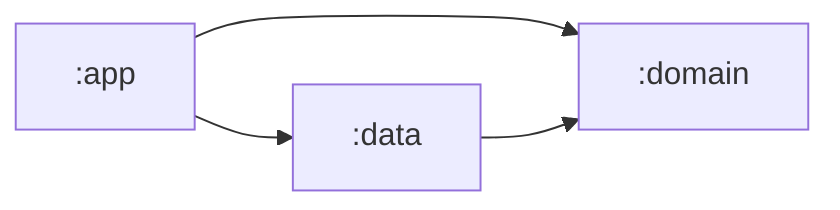

# Step 02 — Project structure: make the architecture a compile-time rule

**Branch:** `step-02-project-structure` · **Tag:** `v0.2.0` · **Previous:** [step 01](01-planning.md) · **Next:** [step 03, domain layer](03-domain-layer.md)

In step 01 we *wrote down* the rules. In this step we make the **tools enforce them**,
before any feature exists. An empty project with the right walls is worth more than a full
project without them: once code piles up, walls are very hard to add.

## What this step adds

```
atmos-android/
├── settings.gradle.kts          ← declares the 3 modules, one repository source
├── build.gradle.kts             ← plugin versions, Spotless, checkLocaleSafeCasing
├── gradle.properties            ← parallel builds, build cache, configuration cache
├── gradle/
│   ├── libs.versions.toml       ← EVERY dependency version, in one file
│   └── wrapper/                 ← pins Gradle 9.9.1 for everyone
├── domain/                      ← Kotlin/JVM library  (no Android!)
│   └── build.gradle.kts
├── data/                        ← Android library     (depends on :domain)
│   └── build.gradle.kts
├── app/                         ← Android application (depends on both)
│   ├── build.gradle.kts
│   └── src/main/
│       ├── AndroidManifest.xml
│       ├── kotlin/…/AtmosApplication.kt   ← @HiltAndroidApp: the composition root
│       ├── kotlin/…/MainActivity.kt       ← "Hello, Atmos" in Compose
│       └── res/  values/ values-tr/ values-ar/ xml/ mipmap-anydpi/ drawable/
└── .github/
    ├── workflows/ci.yml         ← format, casing, lint, tests, build on every PR
    └── dependabot.yml           ← weekly dependency update PRs
```

## Key ideas

### 1. Modules are walls; packages are paint



`:domain` is a **plain Kotlin/JVM module**. It does not have the Android SDK on its
classpath at all. So when someone, human or AI, tries this:

```kotlin
// domain/src/main/kotlin/.../Leak.kt
import android.content.Context

class Leak(val context: Context)
```

the build fails. This is the real output:

```
e: …/domain/Leak.kt:3:8 Unresolved reference 'android'.
e: …/domain/Leak.kt:5:25 Unresolved reference 'Context'.
```

No code review needed: the architecture rule from
[ADR-0001](../architecture/adr/0001-clean-architecture-with-gradle-modules.md) is now a
compiler error.

> **Bonus:** a pure JVM module also compiles and tests faster than an Android one, and
> Gradle builds the three modules in parallel.

### 2. One place for versions: the version catalog
[`gradle/libs.versions.toml`](../../gradle/libs.versions.toml) holds every version.
Modules refer to aliases:

```kotlin
implementation(libs.hilt.android)   // not "com.google.dagger:hilt-android:2.60.1"
```

Upgrading a library changes one line in one file, and Dependabot can open that PR for you.

### 3. One source of repositories
```kotlin
repositoriesMode.set(RepositoriesMode.FAIL_ON_PROJECT_REPOS)
```
No module can quietly add a random Maven repository. It is a small setting with a big
supply-chain-security benefit.

### 4. The composition root
`AtmosApplication` is annotated `@HiltAndroidApp`. Hilt builds the dependency graph from
there. `:app` is the only module that knows both `:domain` and `:data`, so it is the only
place where "this interface is implemented by that class" can be written (from step 04 on).

### 5. A rule a machine can check should be checked by a machine
Our Turkish-locale rule (ADR-0005) is enforced by `checkLocaleSafeCasing`, a ~25-line task
in the root build file. Real output when someone writes `city.uppercase()`:

```
> Pass an explicit Locale when changing text case (see ADR-0005):
  domain/src/main/kotlin/dev/ahmedabusada/atmos/domain/Shout.kt:3: fun shout(city: String) = city.uppercase()
```

Why does this matter? In Kotlin, `"istanbul".uppercase()` uses `Locale.ROOT` and gives
`ISTANBUL`, but a Turkish reader expects `İSTANBUL`. The fix is
`"istanbul".uppercase(Locale.forLanguageTag("tr"))`.

### 6. Lint is strict from day one
`warningsAsErrors = true`. On the very first run, Lint found two real issues:

| Lint said | We fixed it by |
|---|---|
| `localeConfig` only works on API 33+ (`UnusedAttribute`) | Marking the manifest `tools:targetApi="33"`: the attribute is optional on older versions, by design. |
| `allowBackup` is deprecated on Android 12+ (`DataExtractionRules`) | Adding proper backup rules for both old and new Android versions. |

We fixed them instead of disabling the checks. Starting strict is easy; becoming strict
later means fixing hundreds of warnings at once.

### 7. CI from the first commit
[`.github/workflows/ci.yml`](../../.github/workflows/ci.yml) runs on every pull request:

```
spotlessCheck → checkLocaleSafeCasing → lint → test → assembleDebug
```

The same commands work locally, so "it works on my machine" and "it works in CI" mean the
same thing.

## Run it yourself

Requirements: Android Studio (latest stable) or JDK 21 plus the Android SDK.

```bash
git switch step-02-project-structure
./gradlew assembleDebug                                     # build the app
./gradlew spotlessCheck checkLocaleSafeCasing lint test     # all quality checks
./gradlew spotlessApply                                     # auto-fix formatting
```

Then try to break the rules: add `import android.content.Context` to a file in `:domain`,
or call `"abc".uppercase()` anywhere in `src/main`, and run the checks again.

## How a real team would run this step
- **One developer** (usually the tech lead) sets up the skeleton in a single PR, *before*
  the rest of the team starts on features. Otherwise five people create five structures.
- The PR is reviewed by the whole team, because everyone will live in this structure.
- Branch protection on `main` is switched on: "require CI to pass" and "require one
  review".

## How the AI agent helped in this step

| The agent | The human |
|---|---|
| Looked up the **current** stable versions of every tool from the Maven repositories instead of using versions from memory | Approved the toolchain |
| Set up the modules, catalog, Hilt, Spotless, Lint, CI and Dependabot | Reviewed the module boundaries |
| Ran the build and every check, and pasted real output | — |
| Broke the rules on purpose to prove the guards work | — |
| Fixed the two Lint findings properly instead of suppressing them | — |

**What went wrong, and what we learned:**
1. **The plan met reality.** Step 01 planned detekt, but the latest stable detekt does not
   support Kotlin 2.4, and detekt 2.0 is still alpha. The agent reported this instead of
   forcing it, proposed a small custom check, and wrote
   [ADR-0007](../architecture/adr/0007-static-analysis-without-detekt.md). **Lesson:**
   when the plan changes, record the decision; don't silently drift.
2. **Gradle's wrapper task failed** because the installed Gradle (8.14) could not load AGP
   9.5. The agent generated the wrapper in an empty folder instead. **Lesson:** read the
   error, don't retry blindly.
3. **The proxy rate-limited downloads (HTTP 429).** The agent limited parallel workers and
   retried with back-off. That was an environment problem, not a code problem, so the
   build files were not changed to work around it.
4. **A first draft of `MainActivity` was sloppy** (an unused padding call). The agent
   noticed it during self-review and rewrote it before committing. **Lesson:** ask the
   agent to review its own diff before you do.

Prompts: [docs/ai/prompts/step-02-project-structure.md](../ai/prompts/step-02-project-structure.md).

## Exercise for you
1. Add a fourth module `:core:testing` for shared test helpers. Which modules may depend
   on it, and in which configuration (`testImplementation`)?
2. `checkLocaleSafeCasing` can be fooled by `String::uppercase`. Improve the regex, or
   write a proper Android Lint rule.
3. Turn on branch protection for `main` in your own fork.

## Checklist: is step 02 done?
- [x] Three modules; `:domain` cannot see Android (proved)
- [x] Version catalog; one repository source
- [x] Hilt application, single activity, en/tr/ar strings, locale config
- [x] Spotless, Android Lint (strict), locale-safe casing check (proved)
- [x] CI pipeline and Dependabot
- [x] `./gradlew spotlessCheck checkLocaleSafeCasing lint test assembleDebug` passes
- [x] Step guide, prompts and `PROGRESS.md` updated
