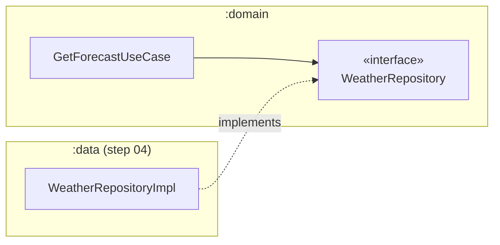

# Step 03 — Domain layer: the business rules, in plain Kotlin

**Branch:** `step-03-domain-layer` · **Tag:** `v0.3.0` · **Previous:** [step 02](02-project-structure.md) · **Next:** [step 04, data layer](04-data-layer.md)

The domain is the heart of the app: **what Atmos knows and decides**, written with no
framework at all. No Android, no Retrofit, no Room, no Compose. It is the part of the code
that changes least and matters most, so we build it first, and we build it with tests.

> **"But there's no API and no UI yet!"** Exactly. The domain *defines* what it needs
> (repository interfaces), and the other layers *provide* it later. This is the
> **Dependency Inversion Principle**, the "D" in SOLID, and it is the whole trick behind
> Clean Architecture.

## What this step adds

```
domain/src/main/kotlin/dev/ahmedabusada/atmos/domain/
├── common/
│   ├── AppResult.kt            ← success or typed failure (ADR-0006)
│   ├── DomainError.kt          ← every failure, in business language
│   └── RunCatchingDomain.kt    ← exceptions → errors, never swallows cancellation
├── weather/
│   ├── Forecast.kt             ← entities: Forecast, CurrentWeather, Hourly/DailyForecast
│   ├── WeatherCondition.kt     ← WMO code → meaning
│   ├── WeatherRepository.kt    ← interface (implemented in step 04)
│   ├── ForecastFreshness.kt    ← "is 30 minutes old too old?"
│   └── GetForecastUseCase.kt   ← cache first, network second, offline fallback
├── location/
│   ├── Coordinates.kt          ← validated latitude/longitude
│   ├── City.kt                 ← City + Place (current location | saved city)
│   ├── Repositories.kt         ← LocationRepository, CityRepository interfaces
│   ├── CityUseCases.kt         ← search, save, remove, observe places
│   └── GetCurrentLocationForecastUseCase.kt
└── settings/
    ├── UserSettings.kt         ← language, theme, units
    ├── Units.kt                ← Temperature / WindSpeed value classes + conversion
    ├── SettingsRepository.kt   ← interface
    └── SettingsUseCases.kt

domain/src/test/…               ← 43 tests and 4 fakes; 90.9% line coverage
```

## Key ideas

### 1. The domain owns the interfaces



`GetForecastUseCase` depends on an *interface* that the domain itself declares. The
implementation in `:data` depends on the domain, not the other way round. So the arrow
of source-code dependency points **inwards**, even though data flows outwards.

### 2. Business rules belong in use cases, not in repositories or ViewModels
The cache-first logic is a **product decision** (F-07, F-08), so it lives in one place:

| Cache | forceRefresh | Network | Result |
|---|---|---|---|
| fresh | false | not used | cached |
| fresh | true | ok | new |
| stale / none | any | ok | new |
| stale / fresh | any | fails | cached, marked outdated with the error |
| none | any | fails | failure |

The repository just *stores and fetches*. The ViewModel just *shows*. Each row of the
table is one test in
[`GetForecastUseCaseTest`](../../domain/src/test/kotlin/dev/ahmedabusada/atmos/domain/weather/GetForecastUseCaseTest.kt).

### 3. Acceptance criteria become test names
US-04 says: *"Given I type fewer than 2 characters, then no search is made."* The test:

```kotlin
@Test
fun `given fewer than 2 characters, then no search is made`() = runTest {
    assertEquals(AppResult.Success(emptyList<City>()), search("i", "tr"))
    assertTrue(repository.searches.isEmpty())
}
```

Read the test files and you are reading the specification.

### 4. Errors are values
```kotlin
when (val result = getForecast(coordinates)) {
    is AppResult.Success -> show(result.data)
    is AppResult.Failure -> showError(result.error)   // the compiler forces this branch
}
```
`DomainError` is a sealed interface, so `when (error)` is exhaustive: add a new error type
and the compiler shows every place that must handle it.

`runCatchingDomain` turns exceptions into errors but **rethrows
`CancellationException`**. Swallowing it is the most common coroutine bug: a screen that
is closed keeps its request running. There is a test that proves it is rethrown.

### 5. Make invalid states impossible
```kotlin
data class Coordinates(val latitude: Double, val longitude: Double) {
    init { require(latitude in -90.0..90.0) { … } }
}
```
The API answers `400` for latitude 999 (we recorded that in step 01). Instead of handling
that error everywhere, we refuse to *create* such a value.

### 6. Value classes for units
```kotlin
@JvmInline value class Temperature(val celsius: Double) {
    fun valueIn(unit: TemperatureUnit): Double = …
}
```
Zero runtime cost, but the compiler stops you passing a wind speed where a temperature is
expected. Values are stored in metric (as the API sends them) and converted only for
display, so switching °C → °F never needs a network call (US-08).

### 7. Time is a dependency
`ForecastFreshness` receives a `java.time.Clock`. Production uses the system clock; tests
use `Clock.fixed(...)`. "Data fetched exactly 30 minutes ago is stale" is tested in a
millisecond, without waiting 30 minutes.

### 8. Fakes over mocks
Tests use small in-memory fakes ([`fakes/`](../../domain/src/test/kotlin/dev/ahmedabusada/atmos/domain/fakes/))
instead of a mocking library. A fake *behaves* like the real thing, so tests check
**outcomes** ("the city is in the list") rather than **interactions** ("`save()` was
called once"). Tests written that way survive refactoring.

### 9. Pragmatism: what we did *not* put in the domain
- **Debouncing search (300 ms)** is about typing speed, a UI concern → ViewModel (step 05).
- **Formatting `12,5°` vs `12.5°`** depends on the locale → presentation (step 05).
- **Resolving `AppLanguage.System`** to a real language needs the device → presentation.

The domain decides *what*; the presentation decides *how it looks*.

## Run it yourself

```bash
git switch step-03-domain-layer
./gradlew :domain:test                   # 43 tests, ~1 second
./gradlew :domain:koverHtmlReport        # coverage report in domain/build/reports/kover/
./gradlew :domain:koverVerify            # fails below 90%, also runs in CI
```

The domain tests run on the plain JVM, with no emulator and no Android SDK. That is why
they are fast enough to run on every save.

## How a real team would run this step
- The domain is usually designed in a **pairing or mob session**: it is where the team
  agrees on the vocabulary (what *is* a "place"? when is data "stale"?).
- Once the interfaces exist, work **parallelises**: one developer builds the data layer
  against `WeatherRepository`, another builds the UI against fake use cases. Neither waits
  for the other.
- PRs in this layer are small and test-heavy. Reviewers read the tests first.

## How the AI agent helped in this step

| The agent | The human |
|---|---|
| Turned each acceptance criterion into a test name, then wrote the implementation | Checked that the tests really match the stories |
| Wrote the decision table for `GetForecastUseCase` and one test per row | Approved the offline behaviour (show cache + banner, not an error) |
| Wrote fakes for every repository | — |
| Set a 90% coverage gate and added it to CI | — |
| Ran the tests and the coverage report and reported the real numbers (43 tests, 90.9%) | — |

**What went wrong, and what we learned:**
1. **A leftover from a different tool.** The first draft of `runCatchingDomain` had
   `@Suppress("TooGenericExceptionCaught")`, a *detekt* rule name, but this project has no
   detekt (ADR-0007). The agent caught it during self-review and removed it. **Lesson:**
   AI agents carry habits from other codebases; review for things that don't belong.
2. **Kotlin vs Java casing.** While writing ADR-0005's check, the agent double-checked a
   detail that is easy to get wrong: Kotlin's `uppercase()` uses `Locale.ROOT`, and Java's
   `toUpperCase()` uses the device locale. Both are wrong for Turkish text, in different
   ways, which is why the rule is "always pass a Locale".
3. **Formatting drift.** One file committed before `spotlessApply` ran was reformatted in
   a later commit. **Lesson:** run the formatter *before* committing (a Git pre-commit hook
   is a good idea in a real team).

Prompts: [docs/ai/prompts/step-03-domain-layer.md](../ai/prompts/step-03-domain-layer.md).

## Exercise for you
1. Add a "feels like" rule: if the wind is above 40 km/h, show a "Windy" warning. Which
   layer does it go in? Write the test first.
2. `SaveCityUseCase` reads the whole list to check for duplicates. When would that become
   a problem, and how would you change the repository interface?
3. Replace one fake with MockK and compare how the test reads.

## Checklist: is step 03 done?
- [x] Entities, value objects and errors with no framework imports
- [x] Repository interfaces for weather, location, cities and settings
- [x] Use cases for every domain acceptance criterion
- [x] 43 tests, line coverage 90.9%, gate at 90% in CI
- [x] Step guide, prompts and `PROGRESS.md` updated
