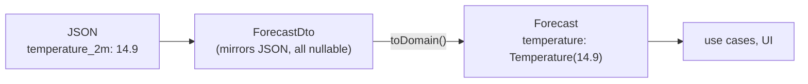

# Step 04 — Data layer: the app's "backend" on the phone

**Branch:** `step-04-data-layer` · **Tag:** `v0.4.0` · **Previous:** [step 03](03-domain-layer.md) · **Next:** [step 05, presentation / UI](05-presentation-ui.md)

A mobile app has its own backend inside it: an HTTP client, a database, a key-value
store, and device services like location. The data layer contains all of them, and
**implements the interfaces the domain declared in step 03**. Nothing outside `:data`
knows that Retrofit, Room or Play services exist.

## What this step adds

```
data/src/main/kotlin/dev/ahmedabusada/atmos/data/
├── remote/
│   ├── dto/ForecastDto.kt, GeocodingDto.kt  ← the JSON, field by field, all nullable
│   ├── OpenMeteoApis.kt                     ← Retrofit interfaces
│   ├── HttpClient.kt                        ← OkHttp: timeouts, User-Agent, JSON config
│   ├── RetryInterceptor.kt                  ← 2 retries, exponential back-off, never on 4xx
│   └── ErrorMapping.kt                      ← the ONLY place that knows HttpException
├── mapper/
│   ├── ForecastMapper.kt                    ← DTO → Forecast (parallel arrays, times, zones)
│   └── CityMapper.kt                        ← DTO → City (drops unusable results)
├── local/
│   ├── Entities.kt, Daos.kt, AtmosDatabase.kt  ← Room: saved cities + forecast cache
│   └── CacheKey.kt                          ← "41.01,28.97", always with Locale.ROOT
├── settings/SettingsRepositoryImpl.kt       ← DataStore
├── location/LocationRepositoryImpl.kt       ← fused location provider, coarse only
├── repository/
│   ├── WeatherRepositoryImpl.kt
│   └── CityRepositoryImpl.kt
└── di/DataModule.kt, Qualifiers.kt          ← Hilt: interface → implementation

data/schemas/…/1.json                        ← exported Room schema, reviewed like code
app/…/di/AppModule.kt                        ← provides the User-Agent (only :app knows the version)
```

## Key ideas

### 1. DTO → mapper → entity



| | DTO | Entity |
|---|---|---|
| Shape | Exactly the JSON (`temperature_2m`, parallel arrays) | What the app means (`temperature`, a list of hours) |
| Nullability | Everything nullable: we don't control the server | Only what is really optional |
| Visibility | `internal` to `:data` | Public, in `:domain` |
| Changes when | The API changes | The product changes |

The mapper is where we decide what the app can live without. A missing hour is
**skipped**; missing current conditions make the whole response **invalid**.

### 2. Test against the real API, recorded
In step 01 we saved real responses to [`docs/api/samples/`](../api/samples/). The data tests
read those **same files** (they are added to the test resources in
[`data/build.gradle.kts`](../../data/build.gradle.kts)), so there is one source of truth.
They caught exactly what we hoped they would:

```kotlin
@Test
fun `given a response with no results key, then returns an empty list`() {
    // The real API omits "results" when nothing matches.
    assertTrue(citiesIn("geocoding_empty.json").isEmpty())
}
```

Without `val results: List<CityDto> = emptyList()` in the DTO, this would crash the first
time a user searched for a typo.

### 3. Errors are translated once, at the edge
```kotlin
internal fun Throwable.toDomainError(): DomainError = when (this) {
    is SocketTimeoutException -> DomainError.Timeout      // before IOException!
    is IOException -> DomainError.NoConnection
    is HttpException -> if (code() == 404) DomainError.NotFound else DomainError.Server(code())
    else -> DomainError.Unknown(this)
}
```
Order matters: `SocketTimeoutException` *is an* `IOException`. A test covers it.

### 4. Retry only what can succeed on retry

| Failure | Retry? | Why |
|---|---|---|
| Network error (`IOException`) | ✅ up to 2× | The connection may come back. |
| HTTP 5xx | ✅ up to 2× | The server may recover. |
| HTTP 4xx | ❌ | Our request is wrong. Sending it again gives the same answer. |

The back-off (1 s, then 2 s) is injected, so tests run with zero delay and still check
the delays were requested.

### 5. Cache the raw response, map on read
The forecast cache stores the downloaded JSON and runs the **same mapper** when reading.
Fresh and cached data can never disagree, and there is no schema of 20 columns to
migrate. If a cached entry can't be parsed (for example after an app update), it is
treated as "no cache", never as a crash.

### 6. Turkish and Arabic, again: the cache key
```kotlin
String.format(Locale.ROOT, "%.2f,%.2f", latitude, longitude)   // "41.01,28.97"
```
With the default locale, a Turkish phone produces `"41,01,28,97"` and an Arabic one uses
Arabic-Indic digits. The user changes language and the whole cache is suddenly
"missing". The test sets each locale as the default and checks the key stays the same.

### 7. Everything is `internal`, except the wiring
DTOs, DAOs, repositories and mappers are all `internal`. `:app` cannot use any of them
directly; it only gets **domain interfaces** through Hilt:

```kotlin
@Binds abstract fun weather(impl: WeatherRepositoryImpl): WeatherRepository
```

This is the composition from ADR-0001, made concrete.

### 8. Threads are the repository's job
Every repository function switches to an injected `@IoDispatcher` itself. Callers (use
cases, ViewModels) never write `withContext(Dispatchers.IO)`. Tests inject a test
dispatcher.

### 9. Privacy by default
- **Coarse** location only (city-level), enough for weather (NF-06).
- The repository **checks** permission; it never asks. Asking is a UI decision (step 06).
- The User-Agent is `Atmos/0.4.0 (Android)`: no device id, no user data.

### 10. Real things in tests, mocks only at boundaries we don't own

| Test | What is real | What is fake |
|---|---|---|
| Mappers | Real recorded JSON | — |
| API | Retrofit, OkHttp, JSON | The server (MockWebServer replays samples) |
| Room DAOs | Room (in memory, via Robolectric) | — |
| Repositories | Retrofit, OkHttp, JSON, mappers | The server; the DAOs (in-memory fakes that behave like the Room ones) |
| Settings | DataStore writing a temp file | — |
| Location | Our repository | Play services client (a mock: it cannot run on the JVM); permission (a lambda) |

Only `DaoTest` needs Robolectric. Everything else runs on the plain JVM, which keeps the
suite fast and avoids depending on an Android simulation where none is needed.

## Run it yourself

```bash
git switch step-04-data-layer
./gradlew :data:testDebugUnitTest        # all data tests, on the JVM
./gradlew :data:koverVerify              # fails below 80% line coverage (also in CI)
```

## How a real team would run this step
- The data layer is often built **in parallel** with the UI, because both only depend
  on the domain interfaces from step 03.
- The **API contract** is the meeting point with the backend team. When they change the
  API, the recorded samples are updated first, and the failing tests show exactly what
  must change.
- **Database schema changes** are reviewed carefully: the exported schema JSON makes them
  visible in the PR diff.

## How the AI agent helped in this step

| The agent | The human |
|---|---|
| Wrote DTOs, mappers, Retrofit services, Room, DataStore, location and Hilt modules | Reviewed the cache design (raw JSON vs tables) |
| Made the tests read the recorded samples from `docs/api` instead of copying them | — |
| Wrote tests for each quirk in the API contract | Checked them against the contract |
| Found the cache-key locale bug while writing the key, and wrote a test for it | — |
| Reported the Maven Central rate limits and worked around them without changing the code | — |

**What went wrong, and what we learned:**
1. **Duplicated fixtures, almost.** The first draft copied the sample JSON into
   `src/test/resources`. Two copies drift apart. The agent replaced the copy with a source
   directory pointing at `docs/api`. **Lesson:** one source of truth, also for test data.
2. **A pointless workaround.** A draft of `SettingsRepositoryImpl` ended with a dummy
   `documentedTypes` list "to keep imports used". It was removed during self-review,
   together with the unused imports. **Lesson:** an AI agent sometimes adds code to
   silence a symptom; ask "why is this here?".
3. **An experimental API.** `Task.await(cancellationTokenSource)` needs an opt-in to an
   experimental coroutines API. The agent switched to the stable `await()` instead of
   adding the opt-in. **Lesson:** don't let experimental APIs into a reference project
   by accident.
4. **The environment fought back.** Maven Central repeatedly answered `429 Too Many
   Requests` for Robolectric's jars in the cloud sandbox, so the agent could not run those
   tests locally. Instead of skipping them, it pushed the branch and let **GitHub Actions**
   run them (CI runs on `step-*` branches for exactly this reason).
5. **CI was red, and the first fix was wrong.** Every Robolectric test failed with
   *"Failed to interact with raw FileDescriptor internals"*. The first guess, opening
   `java.io` to reflection, did not help. So the agent changed two things:
   - It made CI **report one stack trace per failing test class** as a GitHub annotation,
     which showed the real cause: Robolectric calls `jdk.internal.access.SharedSecrets`,
     which JDK 21 hides. The flag `--add-opens=java.base/jdk.internal.access=ALL-UNNAMED`
     fixed it.
   - It questioned why so many tests needed Robolectric at all. Repository tests now use
     in-memory DAOs, and the location permission is a one-method interface, so only the
     Room test still needs Android.

   **Lesson:** when a fix is a guess, first improve what you can *see*. And when a tool
   causes pain in many tests, ask whether those tests should depend on it.

Prompts: [docs/ai/prompts/step-04-data-layer.md](../ai/prompts/step-04-data-layer.md).

## Exercise for you
1. Open-Meteo also offers `uv_index_max` daily. Add it end to end: DTO → mapper → entity
   → test with a new recorded sample.
2. Write a Room migration test for a future version 2 that adds a `nickname` column to
   `saved_city`.
3. Replace `RetryInterceptor` with Retrofit's `CallAdapter` approach, or with a retry in
   the repository using coroutines. Which do you prefer, and why?

## Checklist: is step 04 done?
- [x] Every domain repository interface has an implementation in `:data`
- [x] DTOs and mappers tested against every recorded sample
- [x] Error mapping, retry and timeouts tested
- [x] Room, DataStore and location tested on the JVM
- [x] Coverage gate at 80% on `:data`, added to CI
- [x] Step guide, prompts and `PROGRESS.md` updated
