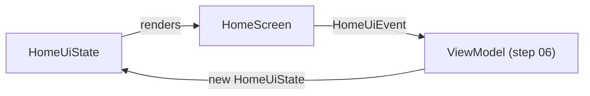

# Step 05 — Presentation: the views, before any data

**Branch:** `step-05-presentation-ui` · **Tag:** `v0.5.0` · **Previous:** [step 04](04-data-layer.md) · **Next:** [step 06, integration](06-integration.md)

This step builds every screen as a **stateless function of a UI state**, with realistic
fake data. No ViewModel, no repository, no network. Nothing is connected yet, and that is
the point: when a screen can only show what it is given, it can be designed, previewed
and reviewed on its own, in every language and theme, before the plumbing exists.

## What this step adds

```
app/src/main/kotlin/dev/ahmedabusada/atmos/
├── ui/
│   ├── theme/        Color.kt, Type.kt, Spacing.kt, Theme.kt   ← the design system
│   ├── format/       WeatherFormatter.kt, LocalFormatter.kt    ← numbers/dates per locale
│   ├── weather/      ConditionUi.kt, ErrorUi.kt                ← domain → label, icon, message
│   ├── components/   Components.kt                             ← icon, banner, skeleton, states
│   └── preview/      AtmosPreviews.kt, PreviewData.kt          ← 4 previews per screen, fake data
└── feature/
    ├── home/         HomeUiState.kt, HomeScreen.kt
    ├── cities/       CitiesUiState.kt, CitiesScreen.kt
    ├── settings/     SettingsScreen.kt
    └── about/        AboutScreen.kt

app/src/main/res/
├── drawable/        11 weather icons + 11 UI icons (vector, no icon library)
├── values/strings.xml, values-tr/strings.xml, values-ar/strings.xml
└── …
app/src/test/…/WeatherFormatterTest.kt   ← formatting checked in en, tr and ar
```

## Key ideas

### 1. A screen is a function: `state → UI`
```kotlin
@Composable
fun HomeScreen(state: HomeUiState, onEvent: (HomeUiEvent) -> Unit, modifier: Modifier = Modifier)
```
- **`state`**: everything the screen can show, as one immutable value.
- **`onEvent`**: everything the user can do, as data (`HomeUiEvent.Refresh`).
- The screen **decides nothing**: it does not know what "Refresh" does. That is the
  ViewModel's job (step 06).



This is **unidirectional data flow** (ADR-0003). The same idea runs SwiftUI, React and
Flutter, so the four Atmos repositories look alike here.

### 2. Model every state, not just the happy one
```kotlin
sealed interface HomeUiState {
    data object Loading : HomeUiState        // skeleton
    data object NeedsLocation : HomeUiState  // no permission, no saved city
    data class Error(val error: DomainError) : HomeUiState
    data class Content(…, val outdatedBy: Duration?, val isRefreshing: Boolean) : HomeUiState
}
```
A sealed interface makes "loading **and** error at the same time" impossible to express.
The `when (state)` in the screen is exhaustive: add a state and the compiler shows where
to draw it.

### 3. Previews are the first test
`@AtmosPreviews` is a multi-preview annotation: one line gives every screen four previews.

| Light | Dark | Arabic RTL | Turkish, font 200% |
|---|---|---|---|

Combined with a `PreviewParameterProvider` that lists every state, Android Studio shows
**every state × every configuration** side by side. A truncated Turkish label or a
mirrored-wrong arrow is visible while you type.

### 4. Formatting belongs to the locale, not to string templates
`"$value%"` is wrong in Turkish, where the sign goes **first** (`%69`). Real output of
the formatter, from
[`WeatherFormatterTest`](../../app/src/test/kotlin/dev/ahmedabusada/atmos/ui/format/WeatherFormatterTest.kt):

| | English | Türkçe | العربية |
|---|---|---|---|
| Percentage | `69%` | `%69` | `69%` (Latin digits) |
| Wind in m/s | `6.9 m/s` | `6,9 m/s` | `6.9 m/s` |
| Thursday | `Thursday` | `Perşembe` | `الخميس` |

Arabic gets Latin digits through the Unicode locale extension `nu-latn`
(`ar-u-nu-latn`), as ADR-0005 decided. Without it, Java prints `١٥` instead of `15`.

The locale comes from the **Compose configuration**, not `Locale.getDefault()`: with the
per-app language setting, the app can be in Arabic while the phone is in English.

### 5. Plurals are not "add an s"
English has two plural forms. Turkish uses one (the noun does not change after a number).
**Arabic has six**: zero, one, two, few, many, other. "Updated 2 hours ago" in Arabic is
`تم التحديث قبل ساعتين`, a dedicated dual form. `<plurals>` resources and
`pluralStringResource` pick the right one; the code never counts.

### 6. RTL comes almost free, if you never say "left"
- Layouts use `start`/`end` and `Arrangement`, so they mirror on their own.
- `LazyRow` starts on the right in Arabic.
- Directional icons (back arrow, chevron, list) have `android:autoMirrored="true"`.
- Weather icons and numbers do **not** mirror: a sun is a sun.

### 7. Accessibility is designed in, not added later (NF-03)
- Each hourly card and daily row is **one sentence** for screen readers
  ("Thursday, Rain, Low 11°, high 18°") via `clearAndSetSemantics`, instead of four
  separate fragments.
- Decorative icons have `contentDescription = null`; meaningful ones are described.
- Section titles are marked as headings, so a screen reader can jump between them.
- Removing a city works with a **visible button** as well as a swipe: swipes are invisible
  to many users and assistive technologies.
- Touch targets are at least 48 dp; text uses `sp` and is previewed at 200%.

### 8. A design system, even for four screens
Colours, type and spacing live in `ui/theme/`. Screens write
`AtmosTheme.spacing.medium`, never `16.dp`. The colour pairs were chosen for WCAG AA
contrast in both themes, and Android 12+ users get colours from their wallpaper
(dynamic colour). Previews turn dynamic colour off, so they look the same everywhere.

### 9. No icon library
The 22 icons are small vector drawables in `res/drawable`. That means no dependency, no
unused icons in the APK, and full control over the weather artwork.

## Run it yourself

```bash
git switch step-05-presentation-ui
./gradlew :app:testDebugUnitTest      # formatter tests in en, tr, ar
./gradlew :app:installDebug           # the app opens on the Home screen with demo data
```

Open any file in `feature/` in Android Studio and switch to **Split** or **Design** view to
see the previews.

## How a real team would run this step
- Designers and developers review **previews** in the pull request, before any wiring.
  Many teams add screenshot tests here (we do that in step 07).
- Translations are sent to native speakers as soon as the strings exist, not at the end.
- The UI and data layers can be built in parallel by different people, because both only
  depend on the domain.

## How the AI agent helped in this step

| The agent | The human |
|---|---|
| Built the design system, all four screens, and previews for every state | Reviewed the layouts against the step-01 wireframes |
| Drew the 22 vector icons as path data | Judged the look of the icons |
| Wrote the strings in English, Turkish and Arabic, including Arabic's six plural forms | Should get a native-speaker review before release (step 07) |
| Wrote formatter tests that pin real locale behaviour (`%69`, `6,9`, Latin digits in Arabic) | — |
| Added accessibility semantics while writing each component | — |

**What went wrong, and what we learned:**
1. **A theme attribute that doesn't exist.** The first icon drawables used
   `?attr/colorControlNormal`, an AppCompat attribute, but this app has no AppCompat
   theme. It compiled, and would have crashed if the drawable was ever inflated by the View
   system. The agent switched to the platform `?android:attr/colorControlNormal`.
   **Lesson:** "it compiles" is not "it works"; resource references fail late.
2. **A needless helper.** A draft of the Cities screen had a home-made
   `Modifier.clickableRow` wrapper around `Modifier.clickable`. It was removed:
   indirection without a reason is a cost for every reader.
3. **Lint about file names.** ktlint asked for `Previews.kt` to be renamed to match its
   only declaration, `AtmosPreviews`. A small rule, but it makes files easy to find.
4. **Changing the plan, openly.** Step 05 first planned ViewModels too. The agent proposed
   moving them to step 06, so that this step is purely "views" and step 06 is "connect
   everything", matching the step list the human asked for at the start.

Prompts: [docs/ai/prompts/step-05-presentation-ui.md](../ai/prompts/step-05-presentation-ui.md).

## Exercise for you
1. Add a "UV index" chip to the Home screen. Start with the UI state and a preview; no
   data yet.
2. Preview the Home screen at 320 dp width in Arabic. What breaks first?
3. Write the Turkish plurals with `one` and `other` identical (as they are). Why does
   Android still need both?

## Checklist: is step 05 done?
- [x] Design system: colours (light, dark, dynamic), type, spacing
- [x] Home, Cities, Settings and About as stateless screens with UI state and events
- [x] Every state previewed in light, dark, Arabic RTL and Turkish at 200% font
- [x] All strings in English, Turkish and Arabic, with correct plurals
- [x] Locale-aware formatter, tested in three languages
- [x] Accessibility semantics on every component
- [x] Step guide, prompts and `PROGRESS.md` updated
