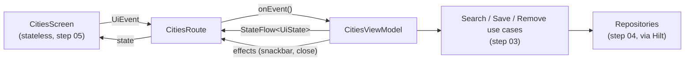

# Step 06 — Integration: connect the views to the real data

**Branch:** `step-06-integration` · **Tag:** `v0.6.0` · **Previous:** [step 05](05-presentation-ui.md) · **Next:** step 07, quality & release

Every piece exists: business rules (step 03), data (step 04), screens (step 05). This step
adds the glue: **ViewModels** that turn use-case results into UI state, **routes** that
connect each screen to its ViewModel and to Android (permissions, snackbars, links), and
**navigation**. After this step, Atmos is a working app.

## What this step adds

```
app/src/main/kotlin/dev/ahmedabusada/atmos/
├── core/
│   ├── SelectedPlaceStore.kt     ← which place Home shows (shared UI state)
│   └── AppLanguages.kt           ← the per-app language: one source of truth
├── feature/
│   ├── home/      HomeViewModel.kt, HomeRoute.kt      ← + location permission flow
│   ├── cities/    CitiesViewModel.kt, CitiesRoute.kt  ← debounce, undo snackbar
│   └── settings/  SettingsViewModel.kt, SettingsRoute.kt
├── navigation/AtmosNavHost.kt    ← type-safe routes
├── MainActivity.kt, MainViewModel.kt  ← theme from settings
└── di/AppModule.kt               ← binds CurrentLanguage, AppLanguageController

domain/src/testFixtures/…/fakes/  ← the domain fakes, now shared with :app tests
domain/…/GetCachedForecastUseCase.kt
app/src/test/…/feature/…ViewModelTest.kt  ← 23 ViewModel tests
```

## Key ideas

### 1. Screen → Route → ViewModel → use cases



| Layer | Knows about | Does not know about |
|---|---|---|
| Screen | `UiState`, `UiEvent` | ViewModels, Android, navigation |
| Route | the screen, the ViewModel, Android (permissions, snackbars, intents) | business rules |
| ViewModel | use cases, `UiState` | Android `Context`, views, navigation |
| Use case | repositories (interfaces) | everything else |

The screens from step 05 did not change at all. That is the payoff of building them
stateless.

### 2. State vs effects
- **State** is what the screen *is*: "showing 3 results". It lives in a `StateFlow`, and a
  rotated screen gets it back.
- **Effects** are things that happen *once*: "show 'Ankara removed · Undo'", "close the
  screen". They go through a `Channel`, so a rotation does not show the snackbar twice.

### 3. Debounce with `transformLatest`
```kotlin
query.transformLatest { text ->
    if (text.length < 2) { emit(SearchState.Idle); return@transformLatest }
    delay(300)                          // cancelled if another letter arrives
    emit(SearchState.Searching)
    emit(searchCities(text, language.tag()).toSearchState())
}
```
One operator gives both behaviours from US-04: wait 300 ms after the last keystroke, and
throw away the result of an older search. The test checks it with **virtual time**:
typing `is`, `ist`, `ista` within 200 ms triggers exactly one search, for `ista`, and the
test takes milliseconds.

### 4. Settings flow in last
```kotlin
val state = combine(load, observeSettings()) { load, settings -> load.toUiState(settings) }
```
The forecast is loaded once; settings are applied on top. Switching °C → °F updates every
screen instantly with **no network call**, and a test proves the fetch count did not change
(US-08).

### 5. One source of truth for the language
On Android 13+, users can change an app's language in the **system** settings. If we
also kept our own copy and re-applied it at start-up, we would silently undo their choice.
So the platform per-app locale is the only source of truth: Settings reads it and writes
it (`AppLanguageController`), and nothing else touches it. The interface keeps the
ViewModel testable without Android.

### 6. The permission flow
1. The first load returns `LocationPermissionDenied` → the Home screen shows
   **NeedsLocation**: the explanation *before* the system dialog (US-01).
2. "Allow location" opens the system dialog.
3. Granted → the ViewModel reloads. Denied → the screen stays, and city search works
   (F-02).
4. After two denials Android stops showing the dialog, so the button opens the app's
   system settings instead.

The ViewModel never sees the dialog; the route handles it and reports the result.

### 7. Shared fakes through test fixtures
The domain fakes moved to `domain/src/testFixtures` (Gradle's `java-test-fixtures`).
`:app` tests use them with `testImplementation(testFixtures(project(":domain")))`. The
ViewModel tests run the **real use cases** on top of fakes, so they test the real
behaviour end to end, minus the network.

### 8. Type-safe navigation
```kotlin
@Serializable data object CitiesDestination
navController.navigate(CitiesDestination)
```
A destination is a type. A typo is a compile error, not a crash.

## Run it yourself

```bash
git switch step-06-integration
./gradlew :app:testDebugUnitTest      # ViewModel + formatter tests
./gradlew :app:installDebug           # the real app, with real weather
```

Try it: deny location (search still works), turn on airplane mode after one load (the
banner appears), switch to العربية in Settings (the whole app mirrors), add and remove a
city (Undo).

## How a real team would run this step
- Integration is where **bugs between layers** appear. Each ViewModel PR is reviewed with
  the app running, not just the diff.
- Manual QA follows the user stories: every acceptance criterion is a checklist item.
- Product reviews the **real** offline and permission flows, which previews cannot show.

## How the AI agent helped in this step

| The agent | The human |
|---|---|
| Wrote the ViewModels, routes, navigation and permission flow | Tested the flows on a device |
| Wrote 23 ViewModel tests from the user stories, with virtual time for the debounce | — |
| Found the language source-of-truth bug while reviewing its own code | Agreed with the fix |
| Moved shared fakes to test fixtures instead of copying them | — |

**What went wrong, and what we learned:**
1. **A bug found in self-review.** The first version re-applied the stored language at
   every start-up. That works until a user changes the language in Android's system
   settings, and then the app silently reverts it. The agent caught it while re-reading
   `MainActivity`, before any test or user did. **Lesson:** ask "who else can change this
   value?" for every piece of state.
2. **A stale value after recreation.** The first fix read the platform language only when
   the settings flow emitted, so after the activity was recreated in the new language,
   the Settings screen could still show the old choice. The ViewModel now keeps the
   language in its own `MutableStateFlow`. A test covers it.
3. **Replacing good data with an error.** The first `HomeViewModel` showed an error screen
   when a pull-to-refresh failed (for example, location unavailable for a moment), even
   though the forecast was on screen. Now a failed refresh keeps the content.
4. **Experimental APIs, made explicit.** `Dispatchers.setMain` and `advanceTimeBy` are
   still marked experimental in kotlinx-coroutines. They are the official way to test
   ViewModels, so the opt-in is written down in one test helper with a comment, not
   silenced across the project.

Prompts: [docs/ai/prompts/step-06-integration.md](../ai/prompts/step-06-integration.md).

## Exercise for you
1. Remember the selected place across app restarts. Where should it be stored, and which
   layer owns that decision?
2. Add "pull to refresh" to the Cities list, refreshing every saved city's forecast. How do
   you keep it from making 10 requests at once?
3. Write a test proving that a search result arriving *after* the user cleared the field
   is ignored.

## Checklist: is step 06 done?
- [x] ViewModels for Home, Cities and Settings, using only use cases
- [x] Routes handle permissions, snackbars, links and navigation
- [x] Debounced search, undo, offline banner, permission flow
- [x] Theme and language applied app-wide; language has one source of truth
- [x] 23 ViewModel tests on the real use cases with shared fakes
- [x] Step guide, prompts and `PROGRESS.md` updated
