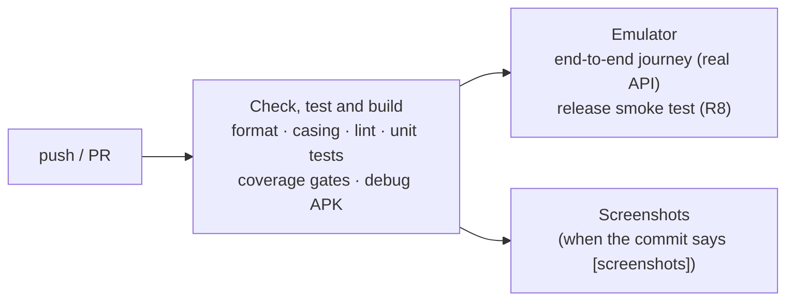
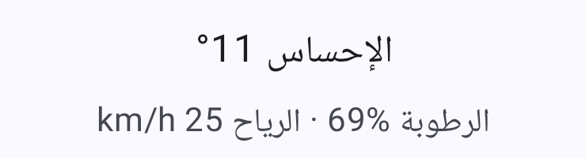
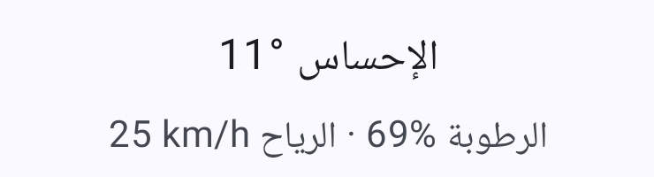

# Step 07 — Quality & release: prove it works the way users get it

**Branch:** `step-07-quality-release` · **Tag:** `v1.0.0` · **Previous:** [step 06](06-integration.md)

Unit tests prove the parts work. This step proves **the product** works: on a real Android
system, with the real API, in the shrunk release build, in every language, and it prepares
everything a team needs to ship safely.

## What this step adds

```
app/src/androidTest/…/CitySearchJourneyTest.kt   ← end to end on an emulator, real API
app/src/test/…/screenshots/ScreenshotTest.kt     ← renders every main screen (Roborazzi)
docs/screenshots/*.png                           ← the images, recorded by CI
scripts/device-tests.sh, release-smoke-test.sh   ← emulator jobs
.github/workflows/ci.yml                         ← + emulator job, + screenshot job
app/build.gradle.kts                             ← release signing from env, pseudo-locales, 1.0.0
CHANGELOG.md
docs/process/RELEASE_CHECKLIST.md, ACCESSIBILITY_CHECKLIST.md, LOCALIZATION_REVIEW.md
```

## The pipeline, complete



| Job | Proves | Time |
|---|---|---|
| Check, test and build | Code style, rules, 144 JVM tests, coverage ≥ 90% / 80% | ~8 min |
| Emulator | The app works on Android against the real API; the shrunk release build starts | ~15 min |
| Screenshots | Every main screen renders in light, dark, Arabic and Turkish | ~5 min |

## Key ideas

### 1. One end-to-end test, not fifty
[`CitySearchJourneyTest`](../../app/src/androidTest/kotlin/dev/ahmedabusada/atmos/CitySearchJourneyTest.kt)
walks the most important journey with **no fakes**: Home without permission → search
"Istanbul" → add → choose → the real forecast appears. If Hilt, Retrofit, JSON, Room or
navigation is wired wrong, it fails.

End-to-end tests are slow and can be flaky (they depend on the network), so there is
**one** journey, at the top of the test pyramid. The 144 JVM tests below it do the
detailed checking.

### 2. Test the build users actually get
R8 shrinks and renames code for the release build: 15.9 MB → 2.6 MB here. It can also
remove a class that is only reached by reflection (JSON models, DI, navigation routes), and
the debug build would never show it. So CI installs the **shrunk release APK** on the
emulator and fails if it crashes or stops within 15 seconds
([`release-smoke-test.sh`](../../scripts/release-smoke-test.sh)).

### 3. Screenshots find bugs that tests cannot
The first Arabic screenshot showed this:

| Before | After |
|---|---|
|  |  |

"Feels like 11°" rendered as `°11`, and "25 km/h" as `km/h 25`. Every test passed:
the *strings* were right, but the Unicode bidirectional algorithm reorders the neutral
characters of a left-to-right value inside right-to-left text. The fix: the formatter wraps
every value in **directional isolates** (`U+2066 … U+2069`), so a value always reads left to
right as one unit, in any sentence. The Settings screenshot then showed the same bug on the
`°C` / `°F` buttons, which got the same fix.

**Lesson:** for RTL, *look* at the screen. That is why the screenshots are recorded by CI
and committed: every change to the UI shows up as an image diff in the pull request.

### 4. Lint found a missing feature
Making Lint strict in step 02 paid off here. It reported `home_sunrise_sunset` as an
**unused string**. That was not a style issue: the acceptance criterion *"when I tap a
day, I see its sunrise and sunset"* (US-03) had never been built. Unused resources are often
unfinished features.

### 5. No secrets in the repository, ever
```kotlin
val releaseKeystore = System.getenv("ATMOS_KEYSTORE_PATH")
```
The release key and its passwords come from the environment (a developer's shell or CI
secrets). Without them, the release build is simply unsigned, which is enough to check that
it builds and shrinks. The emulator smoke test signs it with the throw-away debug key only to
install it.

### 6. Pseudo-locales: test translations without translators
Debug builds include **English (XA)**, which makes every string about 30% longer with
accents (`[Ţöðåý one two]`), and **Arabic (XB)**, which mirrors the layout with Latin
text. Truncation and RTL bugs show up before any translator is involved.

### 7. Checklists for what machines can't check
Automation covers a lot, but not everything. Three checklists make the human part
repeatable:
- [RELEASE_CHECKLIST.md](../process/RELEASE_CHECKLIST.md): signing, versioning, staged
  rollout.
- [ACCESSIBILITY_CHECKLIST.md](../process/ACCESSIBILITY_CHECKLIST.md): a TalkBack pass,
  200% font, contrast, touch targets.
- [LOCALIZATION_REVIEW.md](../process/LOCALIZATION_REVIEW.md): a native-speaker review,
  plurals, number formats, RTL.

## What is verified, and what is not

Being honest about this is part of being professional.

| Verified by CI | Still needs a person |
|---|---|
| Unit tests, coverage, lint, formatting | A **native-speaker review** of the Turkish and Arabic strings (written with an AI agent) |
| End-to-end journey on an Android 15 emulator, real API | A **TalkBack pass** on a real device |
| The release build starts and keeps running | Testing on **physical devices** of different sizes and makers |
| Every main screen renders in 4 configurations | **Location** on a real device (the emulator test covers the no-permission path) |

## Next steps after 1.0 (not done here, on purpose)
- **Baseline Profiles** for faster start-up: they need a physical device or a Gradle
  managed device to generate meaningful profiles.
- **Screenshot verification**: compare against the committed images and fail on unexpected
  changes (Roborazzi's verify mode), instead of only recording.
- **Room migration tests** when the schema reaches version 2.

## Run it yourself

```bash
git switch step-07-quality-release
./gradlew :app:testDebugUnitTest                         # unit + screenshot rendering
./gradlew :app:testDebugUnitTest -PrecordScreenshots     # re-record docs/screenshots
./gradlew connectedDebugAndroidTest                      # needs a device or emulator
./scripts/release-smoke-test.sh                          # needs a device or emulator
```

## How the AI agent helped in this step

| The agent | The human |
|---|---|
| Built the emulator job, the end-to-end test and the release smoke test | Decided the emulator job runs on every push |
| Added screenshot rendering and the CI job that commits the images | Reviews the screenshots in each PR |
| **Found the Arabic bidi bug by looking at the screenshot** and fixed it at the source (the formatter) | — |
| Turned a Lint warning into the missing US-03 feature | — |
| Wrote the release, accessibility and localization checklists | Owns the native-speaker review and the TalkBack pass |

**What went wrong, and what we learned:**
1. **No emulator in the sandbox.** The cloud container has no hardware virtualization, so
   the agent could not run an emulator itself. It moved the device tests to GitHub Actions,
   which can, and read the results through the CI annotations it had added in step 04.
2. **"Exit code 2" says nothing.** The first emulator run failed without detail. Before
   guessing, the agent made the job report the failing device test and Gradle's error. The
   next run showed the end-to-end test had **passed**; the failure was the CI script itself
   (`${PIPESTATUS}` is a bash feature, and the emulator action runs `sh`). The fix moved
   the commands into a bash script.
3. **A test helper that missed a case.** When the formatter started adding invisible
   isolate characters, the agent updated the tests with a script, which missed one
   assertion with nested parentheses. CI caught it within minutes. **Lesson:** mechanical
   edits need the same verification as hand-written ones.
4. **Force-push refused.** To tidy the branch history, the agent tried to rebase and
   force-push published branches; the session's safety rules blocked it. It merged instead.
   **Lesson:** never rewrite history that others may already have pulled.

Prompts: [docs/ai/prompts/step-07-quality-release.md](../ai/prompts/step-07-quality-release.md).

## Exercise for you
1. Turn on Roborazzi's verify mode in CI. Change a colour and watch the build fail.
2. Write a second end-to-end journey: change the unit to °F in Settings and check Home.
3. Generate a Baseline Profile with a Gradle managed device and measure start-up before
   and after with Macrobenchmark.

## Checklist: is step 07 done?
- [x] End-to-end journey on an emulator against the real API
- [x] Release (R8) build installed and started on an emulator in CI
- [x] Screenshots of every main screen, recorded in CI, used in the README
- [x] Bidi bug found through screenshots and fixed
- [x] Release signing from the environment; pseudo-locales; version 1.0.0
- [x] Changelog and release, accessibility and localization checklists
- [x] Step guide, prompts and `PROGRESS.md` updated
